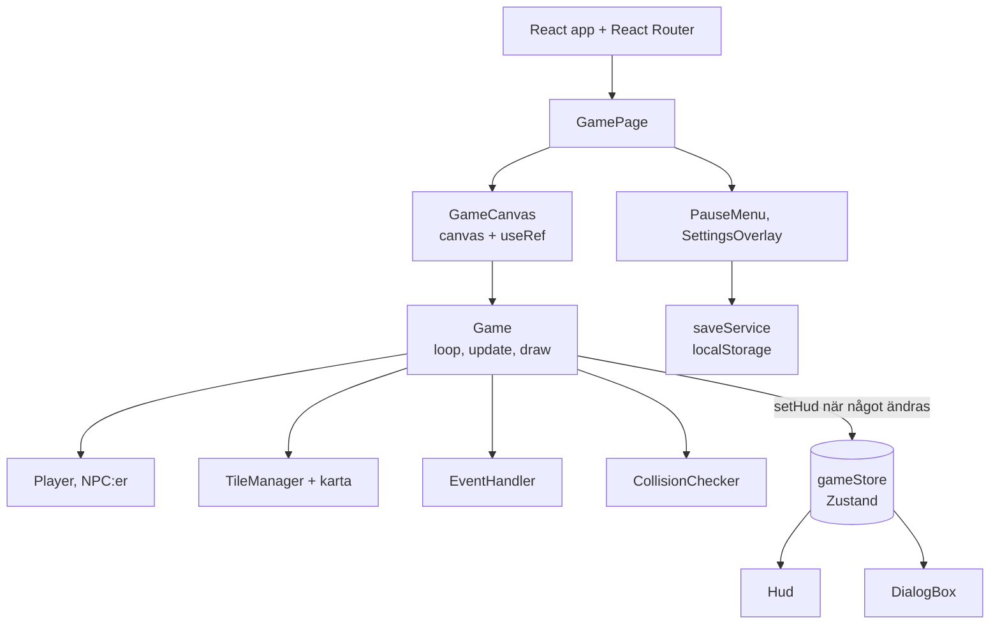

# Browser RPG

Ett top-down 2D-RPG i retrostil som körs i webbläsaren. Spelet är byggt med React, TypeScript och en vanlig HTML `<canvas>`, utan spelmotor. Runt spelet finns ett menylager i React med startsida, sparplatser, inställningar, pausmeny, HUD och dialogruta.

Projektet är mitt examensarbete i frontendutbildningen. Spelmekaniken är inspirerad av RyiSnows tutorialserie _How to Make a 2D Game in Java_.

**Spela:** https://browser-rpg-teal.vercel.app

## Innehåll

- [Funktioner](#funktioner)
- [Kontroller](#kontroller)
- [Kör lokalt](#kör-lokalt)
- [Tech stack och motivering](#tech-stack-och-motivering)
- [Arkitektur](#arkitektur)
- [Hur funktionerna är byggda](#hur-funktionerna-är-byggda)
- [Mappstruktur](#mappstruktur)
- [Arbetssätt](#arbetssätt)
- [Credits och licenser](#credits-och-licenser)

## Funktioner

- ✅ Spelloop i 60 uppdateringar per sekund, oberoende av skärmens uppdateringsfrekvens
- ✅ Egen ö (50 × 50 rutor) med kamera som följer spelaren, kollisioner och animerade tiles (vatten, strand, högt gräs, blommor, fontän)
- ✅ Föremål: nycklar, dörrar, stövlar, kista och svärd
- ✅ NPC (byns äldste) som vandrar, kolliderar och pratar
- ✅ Dialogruta med skrivmaskinstext och Enter för att bläddra
- ✅ Liv med hjärtan i HUD, dold fallgrop som skadar och fontän som läker
- ✅ Svart övertoning mellan scener
- ✅ Start-, instruktions-, sparplats- och inställningssidor med React Router
- ✅ Pausmeny med fortsätt, spara, inställningar och tillbaka till startsidan
- ✅ Tre sparplatser: spara, ladda och ta bort
- ✅ Inställningar: musik- och effektvolym, ljud av, egna tangenter, återställ
- ✅ Egen musik och egna ljudeffekter
- ✅ Global state med Zustand för HUD och dialog
- ⏳ Pekkontroller för mobil (#21)
- ⏳ Monster, strid och inventarie
- ⏳ Inloggning och sparning i databas (M10)
- ⏳ Responsiv layout och tillgänglighetsgranskning med WAVE (M11)

## Kontroller

| Tangent     | I spelet                      | I menyer             |
| ----------- | ----------------------------- | -------------------- |
| W A S D     | Gå                            | W/S flyttar markören |
| Pil upp/ned |                               | Flyttar markören     |
| Enter       | Prata, läsa, bläddra i dialog | Välj                 |
| Esc         | Paus                          | Stäng överlägg       |
| Backspace   |                               | Tillbaka             |

Rörelsetangenterna kan bytas under Inställningar.

## Kör lokalt

Kräver Node.js 20 eller senare.

```bash
git clone https://github.com/Grebbes/browser-rpg.git
cd browser-rpg
npm install
npm run dev
```

Öppna adressen som Vite skriver ut (oftast http://localhost:5173).

| Skript            | Vad det gör                                            |
| ----------------- | ------------------------------------------------------ |
| `npm run dev`     | Startar utvecklingsservern med hot reload              |
| `npm run build`   | Typkontrollerar med TypeScript och bygger till `dist/` |
| `npm run preview` | Visar det byggda resultatet lokalt                     |
| `npm run lint`    | Kör ESLint                                             |

## Tech stack och motivering

| Del          | Val                                     | Varför                                                                                                                                         |
| ------------ | --------------------------------------- | ---------------------------------------------------------------------------------------------------------------------------------------------- |
| Byggverktyg  | Vite                                    | Snabb utvecklingsserver och enkel uppsättning för React + TypeScript                                                                           |
| Ramverk      | React 19 + TypeScript                   | Kursens stack; typade komponenter, props och spelklasser fångar fel tidigt                                                                     |
| Routing      | React Router                            | Egna sidor för start, instruktioner, sparplatser, inställningar och spel                                                                       |
| Global state | Zustand                                 | Spelet (en vanlig klass) och React-komponenterna delar samma data utan att skicka props genom flera led; liten och fungerar även utanför React |
| Spelgrafik   | HTML canvas 2D                          | Ersätter Javas `JPanel` och `Graphics2D`; ingen spelmotor, så logiken går att följa rad för rad                                                |
| Spelloop     | `requestAnimationFrame`                 | Ersätter Javas `Thread`; webbläsaren styr ritningen och pausar i bakgrundsflikar                                                               |
| Styling      | Tailwind CSS + shadcn/ui (Radix)        | Ett enhetligt retroutseende; Radix ger tillgängliga överlägg (fokusfälla, Esc, tangentbord)                                                    |
| Typsnitt     | Press Start 2P och VT323 via Fontsource | Pixeltypsnitt som följer med appen i stället för att bero på installerade typsnitt                                                             |
| Sparning     | localStorage (v1)                       | Ingen server behövs; allt går via en `saveService` så att lagringen kan bytas mot ett API senare                                               |
| Ljud         | `HTMLAudioElement`                      | Räcker för musik och korta effekter; ljuden förladdas och cachas                                                                               |
| Hosting      | Vercel (planerad)                       | Automatisk deploy från `main`                                                                                                                  |

## Arkitektur

React äger sidorna och överläggen. Vanliga TypeScript-klasser äger spelet och ritar på canvasen. React-state uppdateras aldrig 60 gånger per sekund: spelet skriver bara till storen när ett värde faktiskt har ändrats.



## Hur funktionerna är byggda

**Spelloop.** `Game` startar en loop med `requestAnimationFrame`. Tiden sedan förra bildrutan samlas i en ackumulator, och `update()` körs en gång per 1/60 sekund. På 120- eller 144 Hz-skärmar går spelet därför i samma takt. `draw()` ritar i ordningen tiles → föremål → NPC:er → spelare → svart övertoning.

**Spellägen.** `gameState` är `play`, `pause`, `dialogue` eller `transition`, och `update()` kör bara den gren som hör till läget. Pausen sköts av React (Esc öppnar `PauseMenu`). `Game.pause()` sparar läget innan, så att en öppen dialog finns kvar efter pausen.

**Karta och kamera.** Kartan är en textfil med tvåsiffriga tile-index (`world02.txt`) som importeras med Vites `?raw`. Allt räknas i världskoordinater, och kameran räknar om till skärmen med `screenX = worldX − player.worldX + player.screenX`. Bara tiles som syns ritas. Bilderna skalas upp en gång vid laddning, inte varje bildruta.

**Kollisioner.** Varje figur har en `solidArea` (en rektangel inuti rutan). `CollisionChecker` kontrollerar rutorna framför figuren, föremål och andra figurer innan den får flytta sig.

**NPC och dialog.** `Entity` är en abstrakt basklass för spelare och NPC:er. Gubben väljer en ny riktning med jämna mellanrum. När spelaren trycker Enter mot honom startar en dialog. `Game` skriver fram texten en bokstav var tredje bildruta, och Enter har tre lägen: visa hela texten, nästa replik och stäng.

**Events.** `EventHandler` kontrollerar små rektanglar mitt i vissa rutor: en dold fallgrop som tar liv och byter tile efter en svart övertoning, och en fontän som återställer livet när spelaren trycker Enter.

**HUD med Zustand.** `gameStore` innehåller nycklar, liv, maxliv, meddelande och dialogtext. `Game` skriver med `useGameStore.getState().setHud()`, men bara när något skiljer sig från förra gången (`syncHud()` körs varje bildruta). `Hud` och `GamePage` läser med selectors, till exempel `useGameStore((s) => s.life)`, så en komponent ritas bara om när just dess värde ändras.

**Sparning.** `saveService` sparar ett `SaveData`-objekt (position, riktning, nycklar, upplockade föremål) som JSON i localStorage under `browser-rpg:save:1–3`. Spelet laddar en plats via `/play?slot=N`. Sparfilen har ett versionsnummer, så att gamla format kan avvisas.

**Inställningar.** `settingService` sparar volym, ljud av och tangenter i localStorage och slår ihop dem med standardvärden. Ändringar slår igenom direkt i spelet via `Game.applySettings()`.

**Ljud.** `Sound` förladdar alla effekter och spolar tillbaka dem när de spelas. Menymusiken sköts av hooken `useMenuMusic`, som startar vid första tangent eller klick eftersom webbläsare blockerar autoplay.

## Mappstruktur

```
src/
  components/   Hud, DialogBox, PauseMenu, SettingsOverlay, GameCanvas, pixel/ (egna retrokomponenter)
  pages/        StartPage, HowToPlayPage, SaveSlotsPage, SettingsPage, GamePage
  hooks/        useMenuKeys, useBackKey, useMenuMusic
  store/        gameStore (Zustand)
  services/     saveService, settingService
  game/
    Game.ts             loop, spellägen, update(), draw()
    Input.ts            tangentbord
    CollisionChecker.ts
    EventHandler.ts
    AssetSetter.ts      placerar föremål och NPC:er
    Sound.ts
    entities/           Entity, Player, NpcOldMan
    objects/            nyckel, dörr, kista, stövlar, svärd
    tiles/              Tile, TileManager
    maps/               world02.txt
public/
  sprites/      hjälte, NPC, föremål, tiles, UI
  audio/        musik och ljudeffekter (WAV)
```

## Arbetssätt

- **Backlog:** GitHub Projects med issues och milstolpar M0–M11.
- **Versionshantering:** en feature branch per issue och en pull request med `Closes #<nr>` innan merge till `main`. Commits refererar till sin issue (`Refs #19`).
- **Design:** wireframes och klickbar prototyp i Figma, för desktop (1280 × 800) och mobil (390 × 844).

## Credits och licenser

- Spelmekaniken är inspirerad av RyiSnows serie [How to Make a 2D Game in Java](https://www.youtube.com/@RyiSnow). Inga av hans bilder, kartor eller ljud finns i repot.
- Hjälte, NPC, föremål, tiles och ökarta är egna, ritade med hjälp av Claude.
- Musik och ljudeffekter är egna och syntetiserade.
- Typsnitten [Press Start 2P](https://fonts.google.com/specimen/Press+Start+2P) och [VT323](https://fonts.google.com/specimen/VT323) används under SIL Open Font License 1.1.
